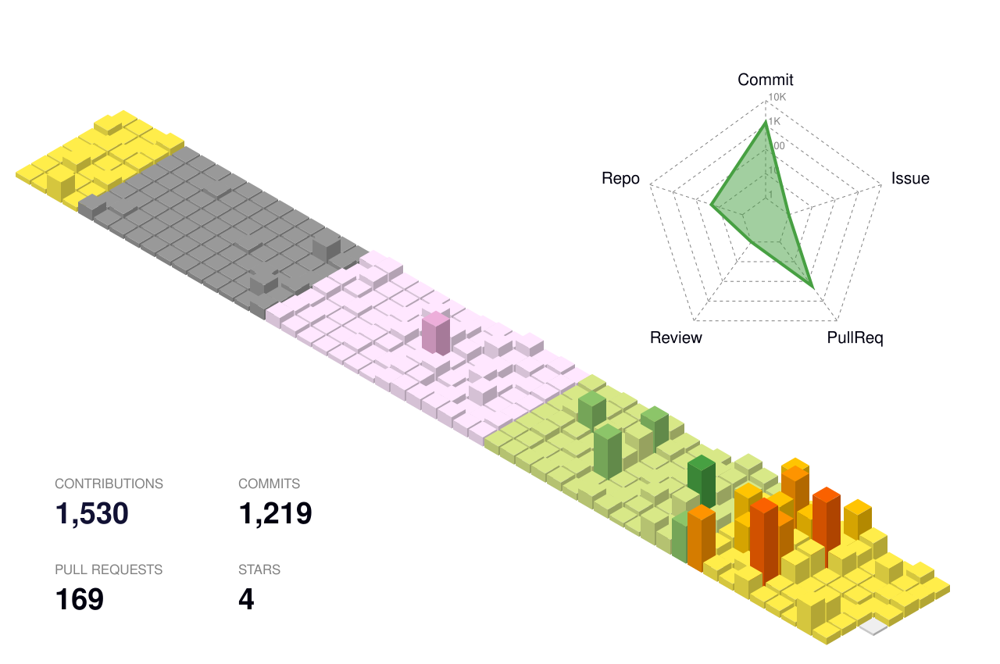

JONGHYUN · MOBILE & SOFTWARE

# Built with care.

**좋아하는 앱을 직접 만들고, 쓰기 편한 경험을 고민합니다.**

앱의 작은 인터랙션부터 그 뒤의 API와 인프라까지.  
보기에는 단순하고, 실제로는 견고한 제품을 만들고 싶습니다.

[Featured app](#featured-app) · [Other work](#other-work) · [Toolkit](#toolkit) · [Contributions](#contributions)

---

## Featured app

### 이거 먹자! · <code>how-about-this</code>

**사진 한 장에서 시작하는 음식 리뷰, 그리고 오늘 뭐 먹을지에 대한 고민까지.**

음식 사진·음식명·별점과 원하는 스타일을 입력하면 리뷰 초안 3개를 생성하고, 마음에 드는 문장을 선택해 복사할 수 있는 Flutter 앱입니다. 음식 추천과 맛집 탐색도 함께 다룹니다.

  

Flutter · Dart · Riverpod · Gemini · Cloudflare Workers

[Project details](https://github.com/JongHyun070105/how-about-this) · [Google Play](https://play.google.com/store/apps/details?id=com.jonghyun.reviewai_flutter)

---

## Other work

### [OpenLoop](https://github.com/JongHyun070105/openloop)

스크린샷과 공지 속 약속·할 일을 구조화하고, **사용자가 확인한 뒤** 일정과 체크리스트로 연결하는 AI Action Calendar입니다.

Flutter · FastAPI · AWS

### [VillageCoverage](https://github.com/JongHyun070105/village-coverage)

제한된 예산과 공급 조건 안에서 농촌 생활서비스 공급안을 비교하는 의사결정 지원 프로토타입입니다. 아직 **현장 검증 전** 단계입니다.

Python · FastAPI · Optimization

[Public demo](https://villagecoverage-public-demo-web.onrender.com)

### [OrchBridge](https://github.com/JongHyun070105/orch-bridge)

여러 AI 코딩 CLI의 작업과 위임·검증·복구를 연결하는 로컬 오케스트레이터입니다.

Python · CLI · Automation

[All repositories](https://github.com/JongHyun070105?tab=repositories)

---

## A little about me

**App first.** 화면을 직접 만지는 재미와 일상에서 쓸모 있는 기능을 좋아합니다.

**Details matter.** 흐름이 끊기지 않는 인터랙션과 자연스러운 사용성을 중요하게 생각합니다.

**Beyond the UI.** 네트워크, API, 배포, 장애 대응처럼 앱을 받쳐 주는 기술도 함께 공부하고 만듭니다.

---

## Toolkit

| | |
| :-- | :-- |
| **Mobile** | Flutter · Dart · Swift · Kotlin · React Native |
| **Web & APIs** | Python · TypeScript · FastAPI · Cloudflare Workers |
| **Systems** | GitHub Actions · AWS · Linux · Networking |

---

## Contributions

  <picture>
    <source media="(prefers-color-scheme: dark)" srcset="./profile-3d-contrib/profile-night-rainbow-clean.svg" />
    
  </picture>

