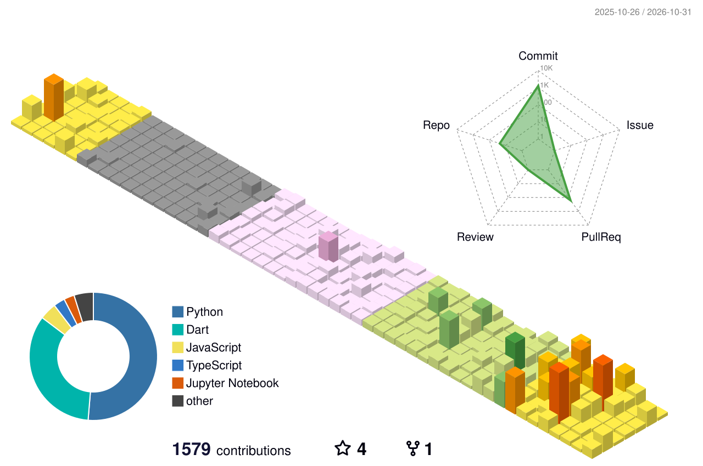

# JongHyun.

**Apps, thoughtfully built.**

앱을 만드는 일을 가장 좋아합니다.  
쓰는 사람에게는 자연스럽고, 그 뒤에서는 제대로 동작하는 소프트웨어를 만들고 싶습니다.

[Featured app](#featured-app) · [Selected work](#selected-work) · [Toolbox](#toolbox) · [Contributions](#contributions)

---

## Featured app

### OpenLoop

**스크린샷 한 장에서, 해야 할 일까지.**

채팅, 공지, 포스터처럼 여기저기 흩어진 정보를 캡처하면 AI가 일정과 할 일을 정리합니다.  
바로 저장하지 않고 **사용자가 확인한 뒤** 캘린더·체크리스트로 이어지는 흐름을 만듭니다.

**Capture → Review → Close**

Flutter · FastAPI · AWS · AI-assisted scheduling

[Explore OpenLoop](https://github.com/JongHyun070105/openloop)

---

## Selected work

### Review AI
사진과 별점, 사용자 입력을 바탕으로 리뷰 문장 초안을 만드는 모바일 앱입니다.  
React Native · Express · Image understanding  
[View project](https://github.com/JongHyun070105/review-ai)

### VillageCoverage
제한된 예산에서 지역별 생활서비스 공급안을 비교하고, 담당자가 근거와 한계를 확인할 수 있도록 만든 의사결정 지원 프로토타입입니다. **현장 검증 전** 단계입니다.  
Python · FastAPI · Optimization · Public data  
[View project](https://github.com/JongHyun070105/village-coverage) · [Try public demo](https://villagecoverage-public-demo-web.onrender.com)

### OrchBridge
여러 AI 코딩 CLI의 작업을 연결하고, 대기열·위임·검증·복구를 관리하는 로컬 오케스트레이터입니다.  
Python · CLI · Agent orchestration  
[View project](https://github.com/JongHyun070105/orch-bridge)

[Explore all repositories](https://github.com/JongHyun070105?tab=repositories)

---

## What I care about

**Small details.** 버튼 한 번, 확인 단계 하나가 사용 경험을 바꾼다고 생각합니다.

**Useful software.** 기술을 보여주기보다 실제 문제를 해결하는 앱을 만들고 싶습니다.

**The system behind the screen.** 앱의 UI뿐 아니라 API, 네트워크, 배포, 실패했을 때의 동작도 함께 고민합니다.

---

## Toolbox

| | Working with |
| :-- | :-- |
| **Mobile** | Flutter · Dart · React Native · Swift · Kotlin |
| **Web & API** | TypeScript · JavaScript · Python · FastAPI |
| **Systems** | Git · GitHub Actions · AWS · Linux · Networking |

More about my projects

- **[TRON Compass](https://github.com/JongHyun070105/tron-compass)** — 사용자 규칙과 검증 가능한 근거를 중심으로 한 TRON 의사결정 실험
- **[Comtus AI](https://github.com/JongHyun070105/comtus-ai)** — 모바일 게임 분석·자동화 아이디어 탐색

---

## Contributions

실제 GitHub 활동을 기반으로 자동 생성되는 3D 기여 그래프입니다.

<picture>
  <source media="(prefers-color-scheme: dark)" srcset="./profile-3d-contrib/profile-night-rainbow.svg" />
  
</picture>

Updated daily with GitHub Actions. The graph represents contributions, not lines of code.

---

*Make it useful. Make it feel simple.*

[GitHub](https://github.com/JongHyun070105) · [All projects](https://github.com/JongHyun070105?tab=repositories)

